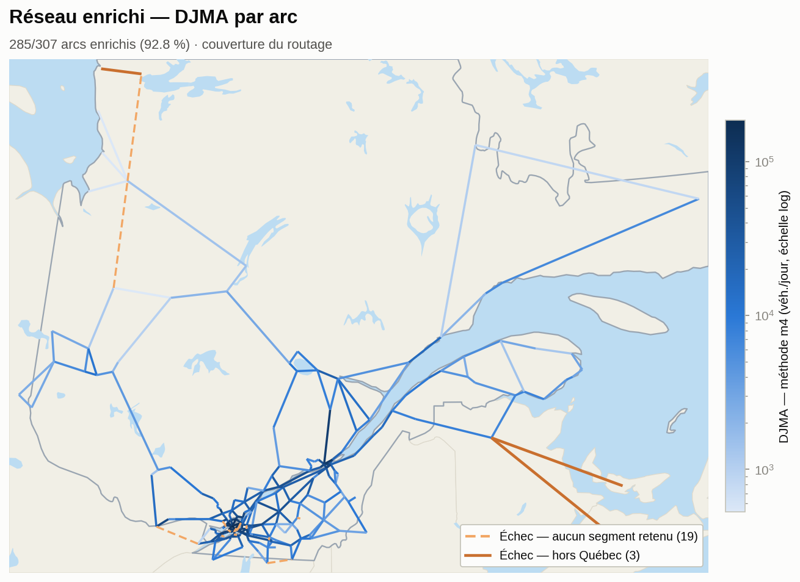
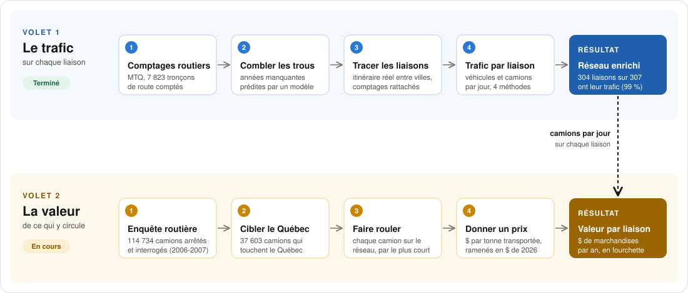
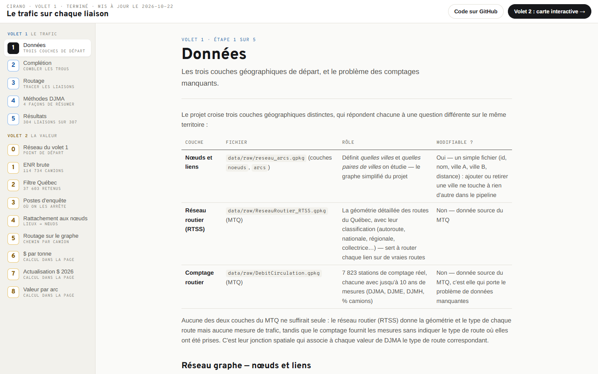
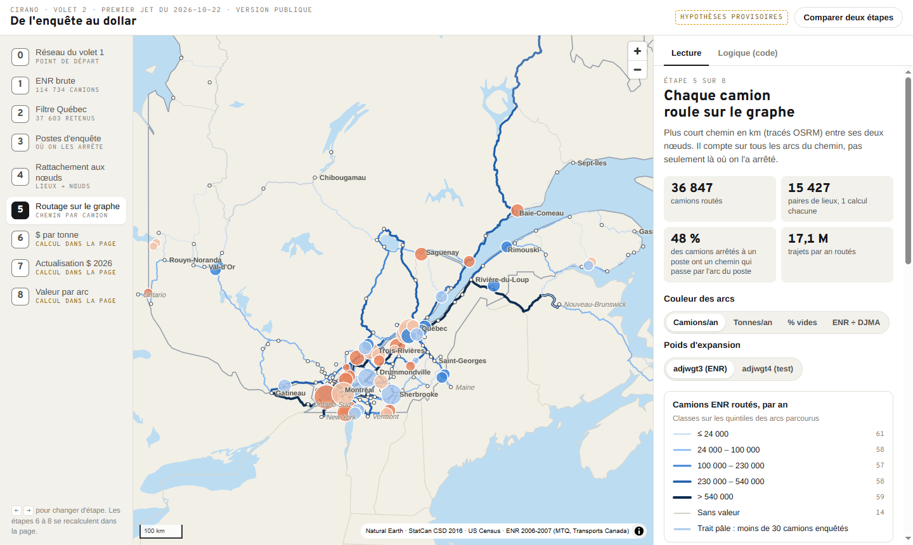

# Résilience du réseau routier québécois

**Combien de camions circulent sur chaque grande liaison routière du Québec, et quelle valeur de marchandises transportent-ils ?**

Projet de recherche mené avec Polytechnique Montréal et le CIRANO, en collaboration avec Transports Canada et le ministère des Transports et de la Mobilité durable du Québec (MTMD).

[](requirements.txt)
[](https://akrambouznad789-cyber.github.io/projet-resilience-cirano/docs/volet1/)
[](https://akrambouznad789-cyber.github.io/projet-resilience-cirano/docs/volet2/carte_interactive.html)

<p align="center">
  
</p>

## En bref

- **Le problème.** Pour savoir quelles routes sont critiques quand une fermeture survient (inondation, effondrement, chantier), il faut d'abord connaître le trafic qu'elles portent, puis la valeur économique de ce trafic.
- **L'approche.** Le Québec est modélisé comme un réseau de 307 liaisons routières entre 207 nœuds (villes, carrefours et points frontière). Chaque liaison reçoit son trafic réel, puis la valeur des marchandises qui y circulent.
- **Résultat du Volet 1.** 304 liaisons sur 307 (99 %) ont un trafic journalier, tiré de 7 823 tronçons de comptage du MTQ dont les années manquantes ont été comblées par apprentissage automatique.
- **Volet 2, en cours.** Une [carte interactive](https://akrambouznad789-cyber.github.io/projet-resilience-cirano/docs/volet2/carte_interactive.html) montre, étape par étape, comment une enquête menée auprès de 114 734 camions devient un montant en dollars par liaison.

## Deux volets successifs

<p align="center">
  
</p>

Les deux volets sont distincts, mais le second s'appuie sur le premier. Le Volet 1 établit **combien** de camions passent chaque jour sur une liaison. Le Volet 2 estime **ce qu'ils transportent**, puis multiplie les deux.

## Volet 1 — Le trafic sur chaque liaison

*Terminé.* Chaque liaison entre deux villes est tracée sur le vrai réseau routier, puis reçoit les comptages du MTQ situés sur son itinéraire.

<p align="center">
  <a href="https://akrambouznad789-cyber.github.io/projet-resilience-cirano/docs/volet1/">
    
  </a>
</p>

**[Parcourir le Volet 1 →](https://akrambouznad789-cyber.github.io/projet-resilience-cirano/docs/volet1/)** Les 5 étapes se lisent dans le même format que la carte du Volet 2 : une barre d'étapes à gauche, commune aux deux volets, et une étape affichée à la fois.

| Indicateur | Valeur |
|---|---|
| Liaisons avec un trafic mesuré directement | 285 sur 307 |
| Liaisons complétées par la liaison voisine | 19 |
| Liaisons hors Québec, sans valeur | 3 |
| **Couverture totale** | **304 sur 307 (99 %)** |

| Étape | En une phrase |
|---|---|
| 1 · [Données](https://akrambouznad789-cyber.github.io/projet-resilience-cirano/docs/volet1/#etape=1) | Les trois couches de départ, et le problème des comptages manquants. |
| 2 · [Complétion](https://akrambouznad789-cyber.github.io/projet-resilience-cirano/docs/volet1/#etape=2) | Comment les trous sont comblés : interpolation, forêts aléatoires, stations voisines. |
| 3 · [Routage](https://akrambouznad789-cyber.github.io/projet-resilience-cirano/docs/volet1/#etape=3) | Comment chaque liaison est tracée et reçoit les bons comptages (3 filtres géométriques). |
| 4 · [Méthodes DJMA](https://akrambouznad789-cyber.github.io/projet-resilience-cirano/docs/volet1/#etape=4) | Les 4 façons de résumer le trafic d'une liaison, et leurs écarts. |
| 5 · [Résultats](https://akrambouznad789-cyber.github.io/projet-resilience-cirano/docs/volet1/#etape=5) | Le réseau final et ses 22 cas particuliers expliqués. |

Les mêmes pages se lisent aussi directement sur GitHub, dans [`docs/`](docs/donnees.md).

## Volet 2 — La valeur de ce qui y circule

*En cours : premier jet d'octobre 2026.* L'Enquête nationale en bordure de route (ENR 2006-2007) a arrêté des camions pour noter leur origine, leur destination, leur marchandise et son poids. Ces camions sont rejoués sur le réseau du Volet 1 pour estimer la valeur moyenne d'un camion sur chaque liaison, puis la valeur annuelle des marchandises qui y circulent.

<p align="center">
  <a href="https://akrambouznad789-cyber.github.io/projet-resilience-cirano/docs/volet2/carte_interactive.html">
    
  </a>
</p>

**[Ouvrir la carte interactive →](https://akrambouznad789-cyber.github.io/projet-resilience-cirano/docs/volet2/carte_interactive.html)** Elle compte 9 étapes, avec la même barre à gauche que le Volet 1, un mode de comparaison entre deux étapes, des prix modifiables et le code de chaque étape. Elle fonctionne dans tout navigateur récent, même sans accélération graphique.

À ce stade, les étapes de données sont réelles : 37 603 camions retenus, 36 847 rejoués sur le réseau. Les prix par tonne et l'actualisation en dollars de 2026 sont encore provisoires ; les montants affichés ne doivent pas être cités. La méthode, les premiers constats et la suite sont décrits sur la page [Volet 2](docs/volet2.md).

## Outils, expliqués simplement

| Outil | À quoi il sert dans ce projet |
|---|---|
| **Python** | Le langage de tous les traitements. Chaque étape est un script qu'on peut relancer de bout en bout. |
| **GeoPandas, Shapely** | Manipuler des cartes comme des tableaux : chaque route ou ville est une ligne avec sa forme géographique. On mesure des distances, on croise des couches, on filtre des tronçons. |
| **scikit-learn** (forêts aléatoires) | Estimer les comptages manquants : le modèle apprend sur les stations complètes, puis prédit les valeurs qui manquent ailleurs. Sa précision est mesurée sur des données mises de côté. |
| **OSRM** | Le « GPS » du projet : il trace l'itinéraire routier réel entre deux villes. |
| **NetworkX** | Calculer des chemins dans un réseau : par où passe chaque camion de l'enquête, de son départ à son arrivée. |
| **QGIS** | Logiciel de cartographie, pour vérifier visuellement les résultats, liaison par liaison. |
| **matplotlib** | Produire les cartes et graphiques de ce dépôt. |
| **MapLibre, JavaScript** | Afficher la carte interactive dans le navigateur, avec un moteur de secours quand la carte graphique n'est pas disponible. |
| **Git, GitHub Pages** | Garder l'historique de chaque modification et publier la carte interactive en ligne. |

**Ce que le projet démontre :** le traitement de données géospatiales à l'échelle d'une province, le comblement de données manquantes par apprentissage automatique avec validation, la modélisation de réseau et le calcul d'itinéraires, la visualisation interactive, et une rigueur méthodologique où chaque hypothèse et chaque limite sont documentées.

## Organisation du dépôt

```
├── scripts/                               Un script par étape
│   ├── completion_donnees_randomforest.py   Volet 1 · combler les comptages manquants
│   ├── algo_jointure_routes_liens.py        Volet 1 · tracer les liaisons, rattacher les comptages
│   ├── calcul_djma_methodes.py              Volet 1 · trafic par liaison (4 méthodes)
│   ├── comparaison_methodes_djma.py         Volet 1 · analyse de sensibilité
│   ├── nettoyage_projet_qgis.py             Volet 1 · projet QGIS livrable
│   ├── generer_figure_donnees.py            Figures des pages Données et Complétion
│   ├── generer_figures_resultats.py         Figures des pages Méthodes et Résultats
│   ├── style_figures.py                     Style commun des figures
│   ├── generer_site_volet1.py               Volet 1 · page web (docs/volet1/)
│   ├── visualisation_volet2.py              Volet 2 · carte interactive (docs/volet2/)
│   └── gabarits/                            Gabarits HTML des deux pages web
├── docs/                                  Une page d'explication par étape, et le site des deux volets
├── figures/                               Cartes et graphiques
├── data/                                  Données d'entrée (MTQ) et résultats (GeoPackage)
├── qgis/                                  Projet QGIS livrable, chemins relatifs
├── portfolio/                             Portfolio cartographique (en anglais)
└── requirements.txt                       Bibliothèques Python
```

## Reproduire

<details>
<summary>Commandes, du clonage aux figures</summary>

```bash
git clone https://github.com/akrambouznad789-cyber/projet-resilience-cirano.git
cd projet-resilience-cirano
pip install -r requirements.txt

# Volet 1
python scripts/completion_donnees_randomforest.py
python scripts/algo_jointure_routes_liens.py      # interroge l'API publique OSRM
python scripts/calcul_djma_methodes.py
python scripts/comparaison_methodes_djma.py
python scripts/nettoyage_projet_qgis.py
python scripts/generer_figures_resultats.py
python scripts/generer_figure_donnees.py
python scripts/generer_site_volet1.py             # page web du Volet 1 (utilise gh, l'outil GitHub)

# Volet 2 : nécessite les microdonnées ENR, qui ne sont pas publiées
ENR_DIR=/chemin/vers/les/fichiers/ENR python scripts/visualisation_volet2.py --publique
```

Le projet QGIS livrable (`qgis/reseau-routier-graphe.qgz`) utilise des chemins relatifs et s'ouvre directement après le clonage.

</details>

## Données et confidentialité

- **Comptages routiers et réseau routier :** MTMD, [Données Québec](https://www.donneesquebec.ca/recherche/dataset/debit-de-circulation), licence CC BY 4.0.
- **Fonds de carte :** Natural Earth (domaine public). **Limites municipales :** Statistique Canada. **Comtés américains :** US Census Bureau.
- **Graphe des liaisons entre villes :** construit pour le projet CIRANO.
- **Enquête nationale en bordure de route 2006-2007** (MTQ, Transports Canada) : microdonnées utilisées sous entente, jamais versées dans ce dépôt. La carte publique n'en montre que des résultats agrégés, par liaison et par poste d'enquête.

## Autres livrables

- **[Portfolio cartographique](portfolio/)** (en anglais) : cinq cartes tirées du projet, en PDF et en version interactive.
- **[Projet QGIS](qgis/)** : le réseau enrichi, prêt à explorer dans QGIS.

<details>
<summary><b>English summary</b></summary>

This research project (Polytechnique Montréal and CIRANO, with Transport Canada and Quebec's Ministry of Transportation) models Quebec's inter-city road network as 307 links between 207 nodes, in two successive phases.

- **Phase 1, completed:** each link receives its real traffic (annual average daily traffic and truck share) from 7,823 provincial count segments. Missing years are filled with machine learning (random forests, validated on held-out data). 304 of 307 links (99%) are covered.
- **Phase 2, in progress:** a national roadside truck survey (114,734 trucks, 2006-2007) is replayed on the network to estimate what each truck carries, then the annual value of goods on each link. An [interactive map](https://akrambouznad789-cyber.github.io/projet-resilience-cirano/docs/volet2/carte_interactive.html) walks through the method step by step. Dollar values are still provisional.

Tools: Python (GeoPandas, Shapely, scikit-learn, NetworkX), OSRM routing, QGIS, MapLibre and JavaScript, GitHub Pages.

</details>

---

**Akram Bouznad** · Polytechnique Montréal / CIRANO
