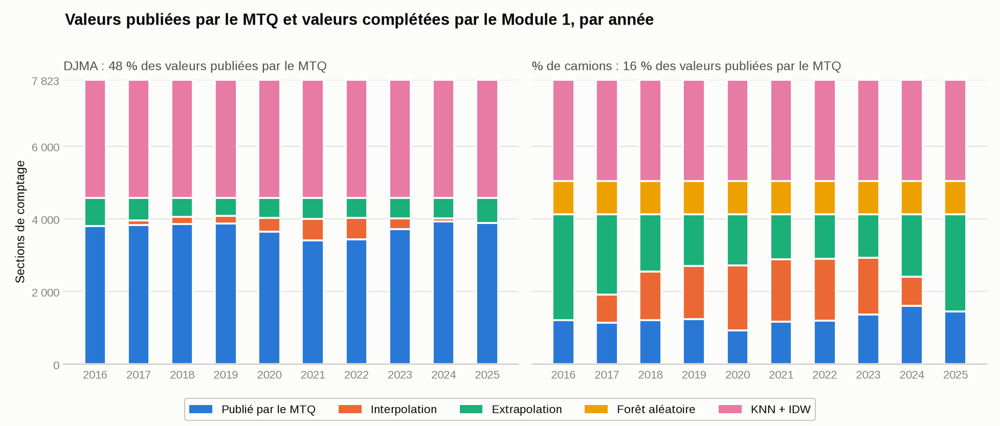
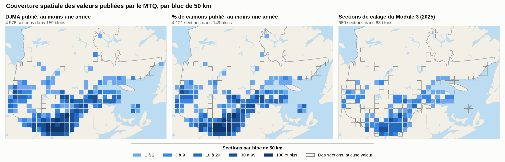

[← README](../README.md) · [Journal du projet](progress.md) · **Atlas des données pour l'apprentissage automatique** · [Carte des pistes de recherche](pistes_ml.md)

---

# Atlas des données pour l'apprentissage automatique

Cet atlas décrit ce que les données du projet permettent d'apprendre, et ce qu'elles ne permettent pas. Pour chaque jeu de données, il donne le schéma, la couverture, les anomalies, la part de valeurs publiées par le ministère et la part de valeurs complétées par le projet, puis les cibles possibles avec leur taille effective et leur piège de fuite.

Chaque chiffre de cette page est recalculé par `scripts/atlas_donnees_ml.py` à partir des fichiers publics du dépôt, et consigné dans [`donnees_ml/agregats.json`](donnees_ml/agregats.json). Font exception ceux de la section sur les tables d'apprentissage : ils viennent de la commande qui écrit ces tables, et sont consignés dans [`donnees_ml/tables.json`](donnees_ml/tables.json). Six audits indépendants, un par famille de données, ont été confrontés au script de l'atlas. L'enquête ENR, confidentielle, n'est décrite que par le code qui la lit : aucun de ses fichiers n'a été ouvert pour cet atlas.

## Trois règles de lecture

**1. « Mesuré » veut dire « publié par le MTQ ».** Le jeu « Débit de circulation » ne contient pas de comptages bruts. Selon sa fiche sur Données Québec, ses débits « sont obtenus selon une méthode statistique d'estimation » appliquée aux données de plus de 4 500 sites de collecte, et ils sont calculés pour le total des deux directions. Le fichier en garde la trace : 99,98 % des DJMA publiés sont des multiples de 10. Dans cet atlas, une valeur est dite *mesurée* quand elle figure dans le fichier du ministère. C'est la meilleure référence disponible, mais c'est déjà une estimation.

**2. Une valeur absente du fichier du ministère a été complétée par le Module 1.** Le fichier complété n'a plus aucune case vide, mais 52 % de ses DJMA et 84 % de ses % de camions viennent de la complétion. Un modèle qui les prend pour cibles apprend la méthode de complétion, pas le trafic.

**3. La taille d'un jeu se compte en blocs, pas en lignes.** Deux sections voisines se ressemblent. Pour qu'une validation mesure la capacité à prédire ailleurs, des carrés entiers de 50 km sont mis de côté. Le nombre de blocs occupés par une cible est sa taille effective.

## Vue d'ensemble

| Jeu de données | Fichier | Grain | Lignes | Dans git | Pour le régénérer |
|---|---|---|---|---|---|
| Comptages publiés | `data/raw/DebitCirculation.gpkg` | section de comptage | 7 823 | oui | téléchargement, Données Québec |
| Réseau routier RTSS | `data/raw/ReseauRoutier_RTSS.gpkg` | sous-route | 12 567 | oui | téléchargement, Données Québec |
| Graphe des liaisons | `data/raw/reseau_arcs.gpkg` | liaison ; nœud | 307 ; 229 | oui | construit à la main pour le projet |
| Comptages complétés | `data/processed/debits_completes.gpkg` | section de comptage | 7 823 | oui | `scripts/completion_donnees_randomforest.py` |
| Module 1, routage | `data/processed/graphe_routier.gpkg` | liaison ; liaison × section | 307 ; 3 306 | oui | `scripts/algo_jointure_routes_liens.py` (service OSRM public) |
| Module 1, trafic par liaison | `data/processed/graphe_routier_djma.gpkg` | liaison | 307 | oui | `scripts/calcul_djma_methodes.py` |
| Graphe RTSS et réseau à plusieurs routes | `data/processed/reseau_multi_routes.gpkg` | lien ; nœud ; route ; section | 22 655 ; 16 460 ; 459 ; 7 823 | non | `uv run jumeau reseau` (environ 30 s) |
| Enquête ENR 2006-2007 | hors du dépôt | camion enquêté | voir la fiche | non | sous entente |
| Tables d'apprentissage | `outputs/ml/*.parquet` | section × année ; nœud ; lien ; lien × section ; lien × année | 78 230 ; 16 460 ; 22 655 ; 46 583 ; 218 700 | non | `uv run jumeau tables` (moins de 10 s) |

Les six premiers fichiers sont suivis par git malgré la règle `data/` du `.gitignore` (ajout forcé, pour un dépôt clonable et exécutable). `data/processed/` contient aussi 18 fichiers non suivis : d'anciennes versions (`_v1`, `_v2`, `_v4`, échantillons) et le réseau à plusieurs routes. Seuls les fichiers du tableau font foi. L'empreinte SHA-256 de chacun est dans `agregats.json` : une table d'apprentissage devrait la citer.

## Mesuré ou complété, valeur par valeur

Le fichier complété ne marque la méthode que par section (`methode_djma`, `methode_cam`). Le statut de chaque valeur se reconstitue en revenant au fichier du ministère : une valeur présente est mesurée, une valeur absente a été complétée, par la méthode que fixe la position de l'année dans la série.

| Statut de la valeur | DJMA | % de camions |
|---|---|---|
| Publiée par le MTQ | 37 344 (47,7 %) | 12 498 (16,0 %) |
| Interpolation, entre deux années publiées | 2 486 (3,2 %) | 11 128 (14,2 %) |
| Extrapolation, avant la première ou après la dernière année publiée | 5 930 (7,6 %) | 17 584 (22,5 %) |
| Forêt aléatoire, section sans aucun % de camions | sans objet | 9 100 (11,6 %) |
| KNN + IDW, section sans aucun DJMA (et, pour le % de camions, sans aucun % publié) | 32 470 (41,5 %) | 27 920 (35,7 %) |
| **Total** (7 823 sections × 10 ans) | **78 230** | **78 230** |

Parmi les extrapolations, 3 078 valeurs de DJMA et 8 811 valeurs de % de camions ne prolongent aucune pente : la section n'a qu'une année publiée, et cette valeur est recopiée sur les neuf autres.



| Valeurs publiées | 2016 | 2017 | 2018 | 2019 | 2020 | 2021 | 2022 | 2023 | 2024 | 2025 |
|---|---|---|---|---|---|---|---|---|---|---|
| DJMA | 3 795 | 3 826 | 3 853 | 3 873 | 3 644 | 3 409 | 3 429 | 3 710 | 3 923 | 3 882 |
| % de camions | 1 203 | 1 141 | 1 210 | 1 232 | 929 | 1 168 | 1 190 | 1 368 | 1 606 | 1 451 |

Le détail par année et par méthode est dans `agregats.json` (`comptages.statut_par_valeur`).

### Quatre pièges trouvés par l'audit

**Des valeurs publiées étaient écrasées (corrigé le 17 novembre 2026).** 455 sections n'ont aucun DJMA, mais le ministère y publie 798 valeurs de % de camions, de 2021 à 2025. Le script de complétion traitait toute section sans DJMA par KNN + IDW, et réécrivait aussi son % de camions : 788 de ces valeurs publiées étaient remplacées par celles des voisins (écart médian de 4,1 points, maximal de 76). Depuis le correctif, ces sections gardent leur propre série de % de camions, et le script vérifie avant d'écrire qu'aucune valeur publiée n'est modifiée. Une cible se lit tout de même dans le fichier brut : le fichier complété ne dit pas, valeur par valeur, ce qui est mesuré.

**Les champs texte du fichier complété ne distinguent plus rien.** Les chaînes `annee_en_cours` à `annee10` y sont reconstruites avec les valeurs complétées. Le Module 3 évite ce piège : `donnees/observations.py` définit une section *observée* à partir du fichier brut seulement.

**La forêt aléatoire a appris sur des cibles en partie complétées.** Elle s'entraîne sur les 3 666 sections dont le DJMA et le % de camions ont au moins une valeur publiée. Leurs cibles sont les 10 % de camions de chaque section, soit 36 660 valeurs : 11 700 sont publiées (31,9 %) et 24 960 sont interpolées, extrapolées ou recopiées (68,1 %). Seules 132 sections ont leurs dix cibles publiées. Les R² publiés de cette forêt (0,306 par segments mélangés, 0,187 par blocs) comparent donc ses prédictions à des cibles dont deux tiers viennent de la complétion temporelle. Ses variables de DJMA sont complétées à 19,2 % (7 042 valeurs sur 36 660).

**Les complétions s'enchaînent.** Le KNN + IDW emprunte aux sections voisines leurs valeurs déjà complétées, y compris les % de camions des 910 sections traitées par la forêt aléatoire. Une valeur KNN peut donc être la moyenne de sorties d'un modèle, elles-mêmes apprises sur des valeurs interpolées.

### Blocs de 50 km

Le bloc d'une géométrie est `⌊x / 50 km⌋_⌊y / 50 km⌋`, pour son centroïde en EPSG:32198. C'est la définition de `scripts/validation_spatiale_randomforest.py` ; le script de l'atlas vérifie qu'elle redonne ses 149 blocs. Les 7 823 sections occupent 182 blocs, très inégaux : la médiane est de 8 sections par bloc, le plus dense en compte 1 003, et les dix plus denses réunissent 56 % des sections.



## Fiches par jeu de données

### Comptages publiés par le MTQ

| | |
|---|---|
| **Schéma** | 7 823 sections, 109 champs. Pour chaque année de 2016 à 2025 : DJMA (débit journalier moyen annuel), DJME (estival, juin à septembre), DJMH (hivernal, décembre à mars), en véhicules par jour ; % de camions. Les valeurs sont stockées en texte, la chaîne vide vaut « non publié ». Aussi : débit de la 30e heure (3 680 sections), codes RTSS de début et de fin, libellés des extrémités. |
| **Couverture temporelle** | 10 ans. Le créneau `i` porte l'année 2026 − `i` pour toutes les sections. 2 716 sections ont leurs dix DJMA, 132 leurs dix % de camions ; 3 247 n'ont aucun DJMA et 3 702 aucun % de camions. |
| **Couverture spatiale** | Longitude −79,5 à −57,1 ; latitude 45,0 à 54,9. 182 blocs de 50 km. |
| **Doublons** | Aucun : ni identifiant, ni numéro de section, ni géométrie. |
| **Anomalies** | 1 520 géométries en plusieurs morceaux dans une couche déclarée en lignes simples. Longueur de 14 m à 174 km (médiane 1,3 km). Dates de début de section jusqu'au 2026-05-25, après la dernière année de débit. Un % de camions publié égal à 0. Valeurs publiées : DJMA de 10 à 199 000, % de camions de 0 à 86,9. |
| **Mesuré ou complété** | Tout est « publié par le MTQ », donc estimé à la source. `index_sectn` et `index_donnees` valent « O » pour 695 sections : celles pour lesquelles le ministère publie des fiches de comptage (lecture probable, non confirmée par le dictionnaire). |
| **Provenance et licence** | MTMD, jeu « Débit de circulation » de Données Québec, CC BY 4.0, mis à jour chaque jour à la source. La date de téléchargement de la copie du dépôt n'est pas consignée (au plus tard juillet 2026). |

### Comptages complétés par le Module 1

| | |
|---|---|
| **Schéma** | Mêmes champs que le fichier publié, valeurs en nombres, plus `methode_djma`, `methode_cam`, `n_djma_original`, `n_cam_original`, `n_bornees_djma`, `n_bornees_cam`, par section. |
| **Méthode par section** | DJMA : complet 2 716, interpolation 736, extrapolation 1 124, KNN + IDW 3 247. % de camions : complet 132, interpolation 622, extrapolation 3 367, forêt aléatoire 910, KNN + IDW 2 792. |
| **Intégrité** | Aucune valeur manquante, aucune valeur négative, aucun % de camions au-dessus de 100. Les 37 344 DJMA et les 12 498 % de camions publiés sont conservés à l'identique (avant le 17 novembre 2026, 788 % de camions publiés étaient remplacés : voir plus haut). |
| **Anomalies** | Avant le 17 novembre 2026, 14 DJMA et 133 % de camions complétés valaient 0 : des extrapolations tronquées à zéro. L'extrapolation est désormais bornée à l'intervalle mesuré de chaque section ; les 9 valeurs nulles restantes recopient l'unique mesure de la section 30625 (route 111), où le ministère publie lui-même 0 % de camions en 2017. |
| **Régénération** | `python scripts/completion_donnees_randomforest.py`, venv `portfolio`, graine fixée (`random_state=42`). Les anciennes versions `debits_completes_v1.gpkg` et `_v2.gpkg`, non suivies, ont une autre empreinte : à ne pas utiliser. |

### Réseau routier RTSS

| | |
|---|---|
| **Schéma** | 12 567 sous-routes, 32 champs, 32 243 km. Numéro de route à 5 chiffres (1 066 routes), code RTSS à 14 caractères, classe fonctionnelle, statut, côté de chaussée, longueur déclarée en mètres (écart médian de 1,25 m avec la géométrie). |
| **Classes** | Autoroute 4 222 lignes (6 576 km), nationale 2 859 (9 087 km), régionale 1 581 (5 585 km), collectrice 1 963 (7 792 km), sans classe 1 659 (763 km), accès aux ressources et aux localités isolées 225 (2 341 km), locale 58 (99 km). |
| **Statuts** | A 12 113 lignes, T 273 (294 km de routes récentes en service), F 139 et R 42 (102 km, sens non confirmé, exclus du graphe). |
| **Doublons, anomalies** | Aucun doublon, aucune géométrie vide ou invalide. 6 695 lignes au code de côté « 0 », 868 « D » et 873 « G » (les deux chaussées d'une route divisée). |
| **Provenance et licence** | MTMD, jeu « Réseau routier - RTSS » de Données Québec, CC BY 4.0, mis à jour chaque jour à la source. |

### Graphe RTSS

| | |
|---|---|
| **Construction** | `uv run jumeau reseau` : sous-routes de statut A ou T, hors rues locales, nouées aux extrémités et aux carrefours, puis plus grande composante connexe. |
| **Taille** | 22 655 liens, 16 460 nœuds, 31 316 km. Degré des nœuds : 582 de degré 1, 4 045 de degré 2, 10 817 de degré 3, 1 016 de degré 4 ou plus. 187 blocs de 50 km. |
| **Ce qui n'est pas une donnée du MTQ** | 173 liens estimés (401,5 km), qui raccordent les morceaux d'une route numérotée à travers une ville. 668 connecteurs d'accès relient les 229 nœuds des liaisons au réseau ; 36 dépassent 8 km, et le plus long mesure 1 197,5 km (nœuds sans route à proximité, rattachés au nœud le plus proche). |
| **Orientation** | Le graphe est non orienté, alors que le RTSS distingue les deux chaussées d'une route divisée. Un débit publié pour le total des deux directions s'attache aux deux chaussées. |
| **Comptages rattachés** | Par la règle du Module 3 (même numéro de route, à 30 m ou moins) : 7 326 sections sur 7 823 se rattachent à au moins un lien, 497 à aucun. 21 870 liens réels sur 22 482 longent une section, soit 98,0 % des km. Une section longe 5 liens en médiane, 109 au plus. |
| **Échantillon** | `--echantillon` (couloir Montréal–Québec) : 13 820 liens, 9 822 nœuds, 12 351 km, 25 blocs. |
| **Dans git** | Non : `reseau_multi_routes.gpkg` se régénère en 30 secondes environ. |

### Graphe des liaisons et sorties du Module 1

| | |
|---|---|
| **Graphe des liaisons** | 307 liaisons. La couche des nœuds a 229 lignes, dont 207 sont reliées par une liaison : 22 nœuds sont isolés. Types : 207 municipalités, 11 nœuds intermédiaires, 11 points frontière. |
| **Anomalies** | Aucun système de coordonnées déclaré (les coordonnées sont en EPSG:32198). 52 noms de nœuds sur 229 sont mal encodés (UTF-8 lu en Latin-1, « Montréal ») ; `donnees/liaisons.py` les répare à la lecture. |
| **Trafic par liaison** | Quatre méthodes d'agrégation (m1 à m4) du DJMA, du % de camions et des camions par jour. Statut : 285 liaisons avec leurs propres sections, 19 complétées par emprunt à la liaison voisine, 3 hors Québec sans valeur. |
| **Mesuré ou complété** | Les 285 liaisons agrègent 2 648 sections (3 306 rattachements), par leur valeur complétée de 2025. Le DJMA de 2025 est publié pour 1 214 de ces sections, le % de camions pour 536. Liaisons dont toutes les sections sont publiées : 70 pour le DJMA, 12 pour le % de camions ; aucune section publiée : 10 et 68. |
| **Sections partagées** | 596 sections comptent dans plusieurs liaisons. |
| **Régénération** | Le routage interroge le service public OSRM, sans version figée : deux exécutions peuvent donner des tracés différents. |

### Réseau à plusieurs routes et sections de calage

| | |
|---|---|
| **Routes** | 459 routes pour 307 liaisons : 404 tirées du RTSS, 55 tracés OSRM repris tels quels. 111 liaisons ont deux ou trois routes. |
| **Sections sur les routes** | 3 648 sections portées par au moins une route (5 415 rattachements). 1 268 sont sur plusieurs routes et 1 014 sur plusieurs liaisons. 26 routes n'ont aucune section. |
| **Sections observées** | 1 279 sections ont un DJMA et un % de camions publiés pour 2025. 680 d'entre elles sont sur une route : ce sont les cibles de calage du Module 3. Elles occupent 88 blocs ; 359 routes sur 459 en portent au moins une. |
| **Piège du fichier** | La couche `sections` porte à la fois les valeurs publiées (`djma_obs`, `pct_cam_obs`, `camions_obs`) et les valeurs complétées (`djma`, `pct_cam`, `camions`). Seules les premières sont des cibles. |

### Enquête nationale en bordure de route (ENR 2006-2007)

Cette fiche décrit la structure de l'enquête d'après le code qui la lit (`scripts/visualisation_volet2.py`, `src/jumeau_cirano/donnees/demande.py`, `src/jumeau_cirano/modele/preparation.py`). Ses volumes sont ceux que le dépôt publie déjà.

| | |
|---|---|
| **Fichiers lus** | Quatre tables jointes par l'identifiant du camion, une ligne par camion : la fiche d'enquête (poste d'interception, marchandise, poids du chargement), les lieux de ramassage et de livraison (code de municipalité de 2001, province ou État, comté américain), les poids d'expansion annuels, et la liste des postes franchis. |
| **Unités** | `n3` : trajets par an que représente un camion enquêté (poids d'expansion). `t3` : tonnes par an, soit le poids du chargement × `n3`. |
| **Population d'étude** | Camions qui chargent ou livrent au Québec, ou qui franchissent un poste québécois. Le jeu complet compte 114 734 camions ; 37 603 sont retenus, dont 9 057 vides (`docs/volet2.md`). |
| **Localisation** | Un lieu canadien est placé par son code de municipalité de 2001, sinon par sa division de recensement, sinon par sa province ; un lieu américain par son comté. Un lieu québécois est rattaché au nœud municipal le plus proche, un lieu hors Québec à des points frontière. |
| **Ce que le Module 3 en tire** | Un artefact local, `outputs/jumeau/artefact/` : paires de lieux avec leurs trajets annuels, itinéraires possibles de chaque paire, postes localisés sur une route, groupes de camions (même paire, même poste d'interception, mêmes postes franchis). Aucun identifiant de camion n'y entre. Volumes publiés : 37 235 camions enquêtés, 20 484 paires de lieux, 257 952 itinéraires, 49 postes localisés, pour une couverture de 69 % (`docs/jumeau.md`, `docs/progress.md`). |
| **Couverture** | 2006-2007, soit environ 18 ans avant les comptages de 2025. Le facteur de croissance du modèle, qui fait le lien, est confondu avec le trafic local. |
| **Confidentialité** | Microdonnées sous entente (MTQ, Transports Canada), lues hors du dépôt par la variable `ENR_DIR`. Sont publiés : les paramètres, les métriques, les résultats par liaison, par route et par poste. Ne sont jamais publiés : un flux entre deux lieux, un itinéraire, une ligne par camion. Les tests et la CI tournent sur des réseaux synthétiques. |

### Sorties publiques du Module 3

`docs/jumeau/criticite_équilibre.csv` (570 scénarios de fermeture : 307 liaisons et 263 routes) et `docs/jumeau/reports_équilibre.csv` (écart de camions par jour, par scénario et par route) sont des sorties du modèle calé. Elles ne sont pas des observations : entraîner un modèle dessus revient à imiter le Module 3.

### Données de référence

Fonds de carte Natural Earth (domaine public), polices libres, dans `data/reference/`. Limites des régions métropolitaines de Statistique Canada (`data/raw/rmr/`, Licence du gouvernement ouvert du Canada) : non suivies par git, et plus lues par aucun script.

## Cibles possibles et tâches ouvertes

La taille effective est le nombre de blocs de 50 km qu'occupent les exemples. Les valeurs complétées ne comptent jamais comme exemples. La [carte des pistes](pistes_ml.md) tire de ces cibles dix questions de recherche, classées, au-delà de celles des labos.

| Cible | Tâche | Exemples | Taille effective | Piège de fuite propre à la cible |
|---|---|---|---|---|
| % de camions d'une section | régression | 12 498 valeurs, 4 121 sections | 149 blocs | Les dix années d'une section se ressemblent : découper par section, puis par bloc. Lire la cible dans le fichier brut : jusqu'au 17 novembre 2026, 788 valeurs publiées étaient écrasées dans le fichier complété. |
| DJMA d'une section | régression, complétion spatiale | 37 344 valeurs, 4 576 sections | 159 blocs | DJME et DJMH sortent de la même estimation du ministère que le DJMA : ce sont des cibles sœurs, pas des variables indépendantes. |
| Camions par jour en 2025 (DJMA × % de camions) | régression, calage du Module 3 | 1 279 sections, dont 680 sur une route | 118 blocs ; 88 pour le calage | Une section peut compter sur plusieurs routes et plusieurs liaisons (1 268 et 1 014 sections) : découper par bloc, jamais par route. |
| Série d'une section | complétion temporelle, prévision | 2 716 séries complètes de DJMA, 132 de % de camions | 159 et 149 blocs au plus | Découpage chronologique obligatoire. Les 3 078 DJMA et 8 811 % de camions recopiés d'une seule année ne sont pas des points de série. |
| Valeur publiée suspecte | détection d'anomalies | 37 344 DJMA, sans étiquette | sans objet | Sans étiquette, l'évaluation passe par des anomalies injectées. Les zéros de l'ancien fichier complété (14 et 133) étaient des artefacts de l'extrapolation, pas des anomalies du trafic ; le 0 % publié de la section 30625 en est peut-être une. |
| Trafic d'une liaison (m1 à m4) | régression | 285 liaisons | 84 blocs | La cible agrège des valeurs en partie complétées (12 liaisons seulement ont tous leurs % de camions publiés). 19 liaisons recopient leur voisine. 596 sections sont partagées entre liaisons. |
| Attribut d'un lien du graphe RTSS | apprentissage sur graphe | 22 482 liens réels ; 1 244 sections étiquetées en 2025, qui longent 8 391 liens | 113 blocs | Une section étiquette 5 liens en médiane : un découpage par lien met la même étiquette des deux côtés. Les 173 liens estimés et les connecteurs d'accès sont des hypothèses. Les deux chaussées d'une route reçoivent le même total. |
| Choix d'itinéraire, demande entre lieux (ENR) | choix discret, estimation de matrice | volumes publiés : 37 235 camions, 20 484 paires de lieux | 49 postes localisés | Les camions d'un même poste et d'une même paire de lieux partagent leurs itinéraires : découper par poste entier, comme la validation actuelle. L'enquête date de 2006-2007. |

## Tables d'apprentissage

`uv run jumeau tables` met en œuvre les règles de cet atlas. Après `uv run jumeau reseau`, la commande écrit cinq tables Parquet dans `outputs/ml/`, hors de git, en moins de 10 secondes ; avec `--echantillon`, elle les écrit pour le couloir Montréal–Québec dans `outputs/ml/echantillon/`. Elle ne lit que les fichiers publics du ministère et le graphe RTSS. Le code est dans `src/jumeau_cirano/donnees/` (`tables.py`, `blocs.py`, `commande.py`), la configuration dans `configs/tables.yaml`.

| Table | Grain | Lignes | Contenu |
|---|---|---|---|
| `sections_annees` | section × année | 78 230 | DJMA et % de camions, publiés et complétés, avec la méthode de chaque valeur ; DJME et DJMH publiés ; type de route, position, longueur et bloc de la section |
| `noeuds` | nœud du graphe RTSS | 16 460 | position, degré, bloc ; jonction nouée par le projet et écart de jonction |
| `aretes` | lien du graphe RTSS | 22 655 | nœuds `u` et `v`, longueur, numéro et classe de route, côté de chaussée, tronçon estimé ou non, position, bloc |
| `aretes_sections` | lien × section | 46 583 | longueur de la section le long du lien (même numéro de route, à 30 m ou moins), bloc de la section |
| `aretes_annees` | lien × année | 218 700 | moyenne des valeurs des sections qui longent le lien, pondérée par la longueur commune, et part de cette longueur dont la valeur est publiée |

Un fichier `meta.json` accompagne les tables : leurs colonnes, la version du code (commit), l'empreinte SHA-256 des quatre fichiers lus et les chiffres de contrôle. Pour tout le Québec, il est copié dans `donnees_ml/tables.json`, suivi par git. Ses empreintes sont celles de `agregats.json` : les tables et l'atlas décrivent les mêmes fichiers.

### Les colonnes d'une mesure

Le DJMA (`djma_…`) et le % de camions (`pct_camions_…`) ont chacun six colonnes dans `sections_annees`.

| Suffixe | Contenu |
|---|---|
| `_cible` | valeur publiée par le MTQ, lue dans le fichier brut ; vide si l'année n'est pas publiée |
| `_complete` | valeur du fichier complété, jamais vide ; à n'employer qu'en variable, avec sa méthode |
| `_mesure` | vrai si la valeur est publiée |
| `_methode` | `mesure`, `interpolation`, `extrapolation`, `recopie` (une seule année publiée), `foret_aleatoire` ou `knn_idw` |
| `_ecrase` | vrai si la valeur publiée a été remplacée dans le fichier complété (aucune depuis le 17 novembre 2026 ; 788 % de camions auparavant) |
| `_n_mesures` | nombre d'années publiées dans la section |

`camions_cible` est le produit des deux cibles, là où elles sont publiées la même année. `djme` et `djmh` ne portent que des valeurs publiées : le Module 1 ne les complète pas.

### Trois garde-fous contre la fuite

**Une cible est toujours une valeur publiée.** La commande refuse d'écrire une table dont une colonne `_cible` porterait une valeur absente du fichier du ministère. Elle vérifie aussi qu'il y a exactement autant de cibles que de valeurs publiées, soit 37 344 DJMA et 12 498 % de camions.

**`exemples(table, cible)` est l'accès conseillé.** La fonction ne garde que les lignes dont la cible est publiée, et retire les colonnes qui la répètent : sa valeur complétée, ses drapeaux et son nombre d'années publiées, toujours d'au moins 1 dans les exemples, mais nul là où l'on voudrait prédire. Pour le DJMA et les camions, elle retire aussi DJME et DJMH, cibles sœurs issues de la même estimation du ministère ; les deux sont publiés sur 33 105 des 37 344 exemples de DJMA. Les autres colonnes `_complete` restent, avec leur méthode : c'est à l'utilisateur de décider s'il accepte une variable complétée.

| Cible | Exemples | Sections | Blocs de 50 km | Colonnes |
|---|---|---|---|---|
| `djma` | 37 344 | 4 576 | 159 | 17 |
| `pct_camions` | 12 498 | 4 121 | 149 | 19 |
| `camions` | 11 693 | 3 666 | 149 | 11 |

**Les étiquettes des liens se recalculent à chaque découpage.** Une section longe 5 liens en médiane, et 1 732 des 46 583 paires lien–section relient deux blocs différents. `aretes_annees` étiquette chaque lien avec toutes les sections. Dans une validation croisée, `etiquettes_aretes(aretes_sections, sections_annees, sections_gardees=…)` n'étiquette les liens qu'avec les sections d'entraînement : une section mise de côté n'étiquette alors aucun lien de l'entraînement.

```python
import pandas as pd
from jumeau_cirano.donnees import tables as t

sa = pd.read_parquet("outputs/ml/sections_annees.parquet")
ex = t.exemples(sa, "pct_camions")       # 12 498 lignes, cibles publiées seulement
groupes = ex["bloc_50km"]                # GroupKFold : des blocs entiers mis de côté
```

### Type de route et jonctions du graphe

- `type_route` vient du code RTSS de la section pour 7 436 sections. Pour 75 autres, il vient des lignes RTSS de même numéro de route que la section longe à 30 m ou moins, selon la règle de rattachement du Module 3. Les 312 restantes n'ont aucune ligne de leur numéro à cette distance, et ce numéro est le plus souvent absent du RTSS : leur type est `Inconnu`, et 69 d'entre elles ont un DJMA publié. `type_route_source` indique lequel des trois cas s'applique. `Autre` regroupe les classes RTSS connues hors des quatre principales (138 sections).
- `jonction_nouee` marque les 10 846 nœuds où le fichier RTSS n'a pas d'extrémité commune : le projet y a noué les lignes. Ce sont surtout des carrefours en T, car le RTSS ne coupe pas ses lignes aux carrefours. `ecart_jonction_m` donne la plus grande distance entre les extrémités des liens qui aboutissent au nœud. Elle dépasse la tolérance de croisement (2 m) à 1 222 nœuds, où une extrémité pendante a été raccordée à la ligne la plus proche (médiane 19,3 m, 9e décile 59,9 m) : ce sont les seules jonctions estimées. Aux nœuds faits d'extrémités communes, elle ne dépasse jamais 0,59 m.
- Les 173 liens `estime` (raccords estimés à travers une ville) ne portent aucune section. Les connecteurs d'accès des villes n'entrent pas dans ces tables : elles décrivent le réseau routier, pas le modèle du Module 3.

### Contrôles

| Tout le Québec | |
|---|---|
| Sections ; blocs de 50 km | 7 823 ; 182 |
| Cibles de DJMA | 37 344 |
| Cibles de % de camions ; valeurs écrasées par la complétion | 12 498 ; 0 (788 avant le 17 novembre 2026) |
| Blocs des sections de la validation spatiale | 149 |
| Sections rattachées au graphe | 7 326 |
| Liens longés par une section | 21 870 |
| Liens étiquetés en camions en 2025 | 8 391 |
| Nœuds ; jonctions estimées | 16 460 ; 1 222 |

Ces chiffres redonnent ceux de l'atlas, calculés par un autre script. Sur tout le Québec, la commande s'arrête si les sections de la validation spatiale n'occupent plus 149 blocs (`blocs_validation_attendus`). Les cibles, DJME et DJMH ont aussi été relues dans le fichier brut par un calcul indépendant du code des tables, qui refait à la main la conversion du texte et la correspondance entre créneau et année : les 78 230 cases de chacune concordent.

## Ce que cet atlas ne mesure pas

Un labo d'apprentissage automatique préenregistre ses hypothèses sur ces mêmes données. Pour ne pas les devancer, l'atlas s'arrête à la structure : aucun modèle n'y est entraîné, et il ne mesure ni l'évolution d'une série d'une année à l'autre, ni le lien entre une cible et une variable, ni la ressemblance entre sections voisines ou liens adjacents.

## Écarts relevés avec la documentation existante

- `docs/donnees.md` parle de « 7 823 stations de comptage réel ». Ce sont 7 823 sections ; 4 576 ont au moins un DJMA publié, et ce DJMA est estimé à la source.
- `docs/completion.md` décrivait le KNN + IDW comme le dernier recours « pour les segments sans aucune mesure d'aucune année ». Le script l'appliquait à toute section sans DJMA, ce qui écrasait 788 % de camions publiés. Corrigé le 17 novembre 2026 : le script et la page concordent.
- `docs/completion.md` appelle « validation honnête » une comparaison à des cibles complétées à 68,1 %. Le passage aux blocs spatiaux n'a pas changé ces cibles.
- Le README et `docs/donnees.md` annoncent 207 nœuds : c'est le nombre de nœuds reliés ; la couche en contient 229.

Ces pages ne sont pas modifiées ici : elles alimentent le site du Module 1.

## Reproduire

```bash
uv run jumeau reseau                          # réseau à plusieurs routes (30 s), hors git
uv run python scripts/atlas_donnees_ml.py     # agrégats et figures (10 s)
uv run jumeau tables                          # tables d'apprentissage dans outputs/ml/, et tables.json (10 s)
```

Le script et la commande échouent si la définition des blocs ne redonne plus les 149 blocs de la validation spatiale. Ils ne lisent que `data/` et n'ouvrent jamais l'ENR.
