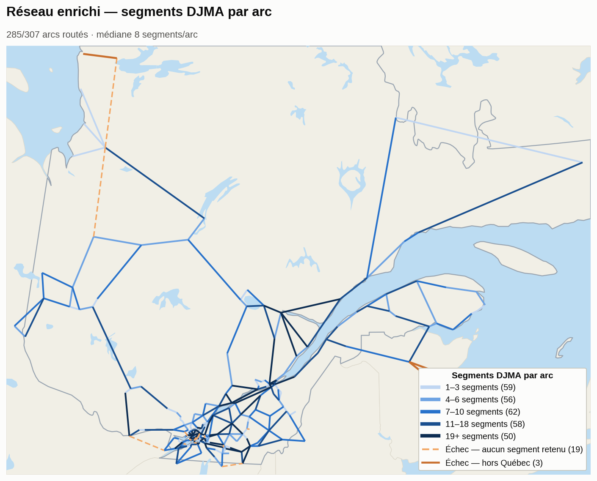

[← Complétion](completion.md) · **Routage** · [Méthodes →](methodes.md) · [README](../README.md)

---

## Routage

Pour chaque arc du graphe (deux villes reliées), le tracé routier le plus optimal entre les deux villes est généré par un algorithme de routage — indispensable vu le nombre d'arcs à traiter (307) et le besoin d'un traitement reproductible et objectif. Ce critère (un seul trajet par arc) pourra être révisé, par exemple en intégrant plusieurs trajets par arc ou en priorisant certains types de routes (autoroutes, routes nationales).

`algo_jointure_routes_liens.py` route chaque paire de villes via l'API **OSRM**, puis associe au tracé les segments du réseau MTQ (`ReseauRoutier_RTSS`) porteurs d'une mesure DJMA, filtrés en 3 passes séquentielles :

```python
def filtre_distance_trace(segs, trace, dist_max_m):
    """Filtre 1 — distance segment complet → tracé (pas du centroïde)."""
    distances = segs.geometry.distance(trace)
    return segs[distances <= dist_max_m].copy()

def filtre_direction(segs, trace, angle_max_deg):
    """Filtre 2 — alignement directionnel segment vs tracé."""
    ...
    return segs[diff_angle(angle_seg, angle_tr) <= angle_max_deg].copy()

def filtre_proximite_ab(segs, pt_a, pt_b, buffer_ab_m):
    """Filtre 3 — exclut les segments trop proches de A ou B (trafic intraurbain)."""
    ...
    return segs[not (trop_proche_de_a or trop_proche_de_b)].copy()
```

| Filtre | Seuil | Rôle |
|---|---|---|
| Distance au tracé | ≤ 400 m | Exclut les routes parallèles captées par erreur |
| Direction | ≤ 45° d'écart | Exclut les segments perpendiculaires (bretelles, croisements) |
| Exclusion intraurbaine | < 3 km de A ou B (arcs de plus de 6 km seulement) | Exclut le trafic de distribution locale près des villes d'origine/destination |

Un clip préalable au territoire québécois (buffer 2 km autour du réseau RTSS) supprime aussi les détours par d'autres provinces avant la recherche de segments DJMA.

### Temps de parcours

Chaque tracé reçoit aussi un temps de parcours, calculé par `temps_parcours_liaisons.py` sans refaire le routage. Le tracé est découpé en tranches de 100 m, et chaque tranche prend la vitesse de la route sur laquelle elle roule :

| Où roule la tranche | Vitesse camion |
|---|---|
| Sur le RTSS (segment à 50 m ou moins) : autoroute | 90 km/h |
| Nationale | 80 km/h |
| Régionale, collectrice | 70 km/h |
| Accès aux ressources | 60 km/h |
| Sans classe (bretelles, raccords) | 50 km/h |
| Hors RTSS, à 8 km ou moins d'une municipalité du graphe : rues | 40 km/h |
| Hors RTSS, plus loin : routes non gérées par le ministère, comme celles de la Baie-James | 70 km/h |
| Dans une autre province ou un État américain | 80 km/h |

Ce sont les vitesses du Module 3 (`configs/reseau.yaml` et `configs/modele.yaml`) : le projet n'a qu'une définition du temps. Le temps d'un arc est la somme, sur ses tranches, de la longueur divisée par la vitesse. Les 307 arcs en ont un, y compris les 3 tracés hors du Québec, qui n'ont pas de trafic. Sur les 285 arcs routés avec succès, le temps médian est de 21 min (longueur médiane : 25,8 km). Les colonnes `temps_min`, `vitesse_moy_kmh`, `part_autoroute` et `part_hors_rtss` sont dans `graphe_routier.gpkg` et `graphe_routier_djma.gpkg`.

Le Module 3 calcule déjà un temps pour la route la plus rapide de chaque liaison. Sur les 252 liaisons qu'il trace sur le RTSS, les deux temps concordent : rapport médian 0,99, 73 % des liaisons à ±10 %. Sur les 55 autres, le Module 3 roule à 70 km/h faute de route sur le RTSS ; le temps du tracé y est plus long de 13 % en médiane, surtout parce que les rues des villes y roulent à 40 km/h.

Limites :

- C'est un temps sans congestion, sans arrêt ni heure de pointe. Le RTSS ne donne pas les limites de vitesse : les vitesses par classe sont une hypothèse.
- Le tracé OSRM (profil voiture) n'est pas toujours le plus rapide pour un camion. Nicolet – Drummondville emprunte des routes hors RTSS : 53 min, contre 47 min pour la route la plus rapide du Module 3.
- Les traversiers comptent comme des routes (liaisons vers Terre-Neuve-et-Labrador).
- « Hors du Québec » se lit dans les contours des autres provinces et des États (Natural Earth, 1:50 M), et non à 2 km du RTSS comme pour le clip ci-dessus : au centre de Montréal, des rues sont à plus de 2 km du RTSS, et le clip les compte hors du Québec.

### Vérification

Le filtrage en cascade a fait l'objet d'une vérification manuelle sommaire, pas d'une validation statistique sur l'ensemble du réseau. Dans QGIS, un arc à la fois est isolé (couches « tracé routé » et « segments retenus » filtrées sur son identifiant), puis le trajet, les segments retenus et l'arc lui-même sont comparés visuellement.

Sur une dizaine d'arcs, environ 95 % des cas sont concluants : les segments retenus correspondent bien au tracé. Les cas mis en défaut sont de deux types — des segments sans lien avec l'arc, captés malgré les filtres, et des segments dont le tracé diverge légèrement de celui de l'arc sans dépasser le seuil de rejet. Cette vérification reste exploratoire : elle montre que la méthode se comporte comme prévu dans la grande majorité des cas, sans valider exhaustivement les 307 arcs.

### Arcs sans segment retenu

Sur les 307 arcs, 22 ne retiennent aucun segment : 3 sortent du territoire québécois et 19 sont en statut `aucun_djma`. Ces 19 ne sont pas dépourvus de stations à proximité : chacun compte entre 2 et 44 segments de comptage dans la zone de recherche de 1,5 km autour du tracé. Le rejeu des filtres montre à quelle étape le dernier candidat disparaît :

| Étape qui écarte le dernier candidat | Arcs |
|---|---|
| Distance au tracé (aucun segment à ≤ 400 m) | 6 |
| Direction (segments restants mal orientés) | 5 |
| Exclusion des abords de A/B | 8 |

Ces arcs sont complétés en aval par emprunt au plus proche voisin (voir [Méthodes](methodes.md#complétion-géographique-des-échecs)).

### Segments par arc

Le nombre de segments DJMA retenus (`n_segs_djma`) varie fortement d'un arc à l'autre — de 1 à 108 sur les 285 arcs routés avec succès, médiane à 8.



Cette taille d'échantillon par arc sert de base pour évaluer, arc par arc, quelle méthode d'agrégation DJMA (m1-m4, voir [Méthodes](methodes.md)) est la mieux justifiée.

---

[← Complétion](completion.md) · [Méthodes →](methodes.md) · [README](../README.md)
