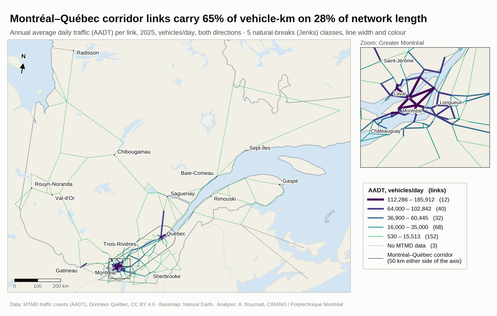

# Spatial data portfolio: Quebec inter-city road network

Maps from a research project on the resilience of Quebec's road network (CIRANO / Polytechnique Montréal, with Transport Canada and the MTMD). Each map answers one question, and its title states a finding computed from the data.

**[Download the PDF portfolio](portfolio_Akram_Bouznad.pdf)**: one map per page, each with the question it answers, the data and method, and the decision it supports.
**Interactive map:** [`carte_interactive.html`](carte_interactive.html). Hover over a link to see its traffic, its truck share and the source of each value.



| # | Map | Question |
|---|---|---|
| 1 | [Network overview](png/01_network_overview.png) | Where are the cities and links, and how concentrated is the network? |
| 2 | [Traffic (AADT)](png/02_traffic_aadt.png) | Which links carry the most traffic? |
| 3 | [Data provenance](png/03_data_provenance.png) | How much of each link's value is observed, and how much is filled in? |
| 4 | [Method sensitivity](png/04_method_sensitivity.png) | Does the result depend on how segment counts are aggregated? |
| 5 | [Phase 2 method preview](png/05_phase2_method_preview.png) | How can a roadside truck survey become a dollar value per link? *(work in progress)* |

## Reproduce

```bash
pip install geopandas matplotlib mapclassify folium
python portfolio/make_maps.py
```

The script reads the project's existing outputs and never modifies them. It writes every figure in this folder, and it writes every number quoted on the maps to [`chiffres.txt`](chiffres.txt).

## Data and licences

- Traffic counts (AADT) and road network: Ministère des Transports et de la Mobilité durable (MTMD), [Données Québec](https://www.donneesquebec.ca/recherche/dataset/debit-de-circulation), CC BY 4.0.
- Basemap: [Natural Earth](https://www.naturalearthdata.com/), public domain.
- Inter-city road graph: built for the CIRANO project.
- Phase 2 (map 5) uses an illustrative network only. Roadside survey microdata are held under a data-sharing agreement and are not published here.

Analysis: Akram Bouznad, CIRANO / Polytechnique Montréal.
